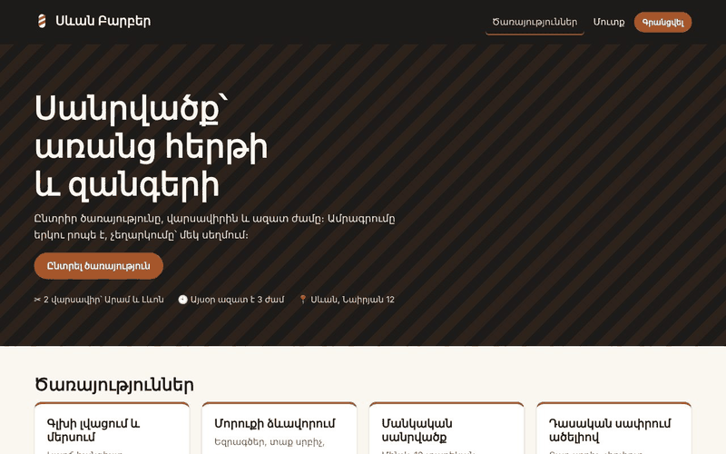

# Սևան Բարբեր

Վարսավիրանոցի առցանց ամրագրում․ հաճախորդը ընտրում է ծառայությունը, վարսավիրին և ազատ ժամը,
վարսավիրը տեսնում է իր օրը, ադմինը կառավարում է ծառայություններն ու բոլոր ամրագրումները։
Երկու հաճախորդ չեն կարող ամրագրել նույն ժամը՝ նույնիսկ նույն միլիվայրկյանին սեղմելով։

**Demo՝** https://sevan-barber.example.am · մուտք՝ `demo@sevanbarber.test` (գաղտնաբառը՝ պահոցի About-ում)



## Stack

PHP 8.3 · Laravel 12 · MySQL 8 · Blade · Fortify · vanilla JS (ES modules, fetch) · սեփական CSS (առանց ֆրեյմվորքի)

## Features

- 6 ծառայություն՝ գնով և տևողությամբ, ազատ ժամեր 7 օր առաջ՝ ըստ օրվա և վարսավիրի
- Ժամի ընտրություն առանց վերբեռնման (`/api/slots`), առանց JS-ի՝ նույնը GET ֆորմայով
- Ամրագրում, «Իմ ամրագրումները», չեղարկում fetch-ով (մինչև այցից 2 ժամ առաջ)
- Վարսավիրի օրը․ իր այցերը, հաճախորդի հեռախոսը, «Կատարված», «Չեղարկել»
- Աշխատանքային ժամերի ավելացում՝ «10-ից 19» → 9 պատուհան, կրկնվողները բաց են թողնվում
- Ադմին՝ ծառայությունների CRUD (soft delete և վերականգնում), բոլոր ամրագրումները ֆիլտրերով և էջավորմամբ
- Երեք դեր՝ admin · staff · client, գրանցումը՝ միայն client
- Հայերեն սխալներ, 403/404/419/429/500 էջեր, աշխատում է 360px լայնությամբ

## The hard part ⭐ — կրկնակի ամրագրման արգելք

Միամիտ լուծումը՝ «ստուգիր, որ ժամն ազատ է, ապա ավելացրու ամրագրում», ունի պահ երկու քայլի միջև,
երբ երկրորդ հարցումը նույնպես տեսնում է ժամը ազատ։ PHP-ում այդ պահը փակելը դժվար է, բազայում՝ մեկ տող․

```php
// bookings միգրացիա
$table->unsignedBigInteger('active_slot_id')->nullable()->unique();
```

Ակտիվ ամրագրման դեպքում `active_slot_id = time_slot_id`, չեղարկելիս՝ `NULL`։ UNIQUE ինդեքսը թույլ է տալիս
շատ `NULL`, ուստի չեղարկված ժամը կարելի է նորից ամրագրել, իսկ երկու ակտիվ ամրագրում նույն ժամին բազան չի ընդունի։
`BookingService::book()`-ը բռնում է `UniqueConstraintViolationException`-ը և վերադարձնում
«Այս ժամը հենց նոր զբաղեցրեցին»։

Ինչու ոչ պարզապես `UNIQUE(time_slot_id)`․ այդ դեպքում չեղարկված ամրագրման տողը ընդմիշտ կզբաղեցներ ժամը,
և կամ պետք կլիներ ջնջել այն (կորչում է պատմությունը), կամ ժամը այլևս չէր ազատվի։

Երկրորդ սահմանը՝ մեկ հաճախորդին առավելագույնը 3 ակտիվ ամրագրում։ Այստեղ UNIQUE չի օգնի, ուստի
տրանզակցիայում կողպում եմ հաճախորդի տողը (`lockForUpdate`)․ նույն հաճախորդի երկու ներդիրի հարցումները
հաշվում են ամրագրումները հերթով, ոչ միաժամանակ։

**Ինչպես եմ ստուգել։** 6 տարբեր հաճախորդ ուղարկում են `POST /bookings` նույն ժամի համար զուգահեռ (4 PHP worker)․
միշտ 1 հաջողություն և 5 «զբաղեցրեցին»։ HeidiSQL-ում նույն `active_slot_id`-ով ձեռքով `INSERT`-ը
ստանում է `Duplicate entry`։ Մանրամասները՝ [docs/smoke-test.md](docs/smoke-test.md)։

## Security decisions

- `role`-ը `$fillable`-ում չէ․ գրանցման ֆորմային ավելացված `role=admin`-ը անտեսվում է, գրանցվողը միշտ `client` է
- `Booking`-ը ընդհանրապես չունի `$fillable`․ ամրագրումը ստեղծում է միայն `BookingService`-ը՝ դաշտ առ դաշտ, գինը՝ ծառայությունից, ոչ ֆորմայից
- Չեղարկումը ստուգվում է `BookingPolicy`-ում՝ կոնտրոլերում (`Gate::inspect`)․ հաճախորդը՝ միայն իրենը և 2 ժամ առաջ, վարսավիրը՝ միայն իր ժամերը։ Կոճակը թաքցնելը (`@can`) միայն հարմարություն է
- Վարսավիրը տեսնում է միայն իր այցերը․ ֆիլտրը սերվերում է (`staff_id = auth()->id()`), ոչ URL-ում
- API-ն վերադարձնում է միայն ժամ և վարսավիրի անուն (`SlotResource`), ոչ էլ. հասցե, ոչ հեռախոս
- Ադմինի ֆիլտրերը՝ սպիտակ ցուցակով (`Booking::STATUSES`, վարսավիրների id-ներ), որոնումը՝ պարամետրով
- `{!! !!}` չկա ոչ մի տեղ․ հաճախորդի «նշումը» `<script>`-ով ցույց է տրվում որպես տեքստ
- `confirm()`-ի տեքստում օգտագործողի տվյալ չկա․ Blade-ի `{{ }}`-ը պաշտպանում է HTML-ը, ոչ JS տողը
- Ժամը ջնջել կարելի է միայն եթե երբեք ամրագրում չի ունեցել․ FK-ն `restrict` է, ուստի պատմությունը չի կորչում
- Մուտք՝ 5 փորձ րոպեում՝ ըստ հասցեի և IP-ի, ելքը՝ POST + `@csrf`

## How I used AI

- Asked to explain why my first version (`exists()` check, then `create()`) still allowed double bookings in a test with two tabs. The explanation (race between check and insert) led me to the UNIQUE `active_slot_id` idea, which I designed and wrote myself
- Generated the first draft of Armenian validation messages; I rewrote them so that attribute names with the article («անվանումը») don't get a second «-ը»
- Asked for a review of `BookingController`: it pointed out that `cancel()` returned 500 instead of 403 for JSON requests. I switched to `Gate::inspect()` with a message
- Asked how to make the seeder work on hosting without Faker (`composer install --no-dev`)
- Did NOT use AI for `BookingService`, `BookingPolicy` or the migrations

## Run locally

```bash
git clone https://github.com/<you>/sevan-barber.git
cd sevan-barber
composer install
cp .env.example .env          # DB_*, APP_LOCALE=hy
php artisan key:generate
php artisan migrate:fresh --seed
php artisan serve
```

Տեղական հաշիվներ (միայն seed-ից)՝ `admin@sevanbarber.test / Admin-12345`, `aram@sevanbarber.test / Staff-12345`,
`demo@sevanbarber.test / Demo-12345`։ Ժամերը ստեղծվում են այսօրվանից, ուստի demo-ն միշտ թարմ է։

## Docs

- [docs/proposal.md](docs/proposal.md) — թեմայի առաջարկ (շաբաթ 1)
- [docs/schema.md](docs/schema.md) — սխեման և ON DELETE որոշումները
- [docs/smoke-test.md](docs/smoke-test.md) — ստուգումը hosting-ում
- [docs/defense-plan.md](docs/defense-plan.md) — պաշտպանության պլան

## What I would do next

- SMS հիշեցում այցից մեկ օր առաջ (queue + scheduler)
- Ծառայություններ 60 րոպեից երկար՝ երկու հաջորդական պատուհան մեկ ամրագրմամբ
- Վարսավիրի արձակուրդի օրեր
